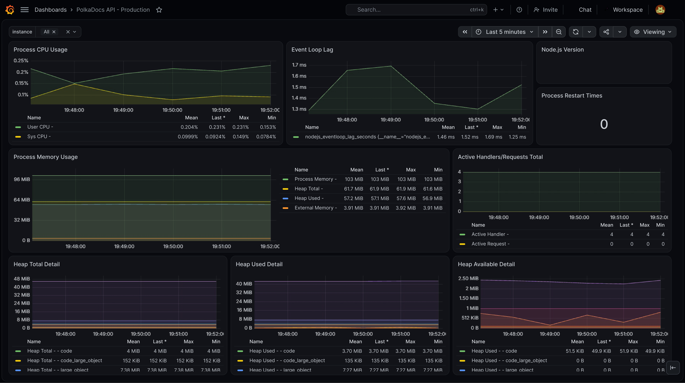

# 📚 PolkaDocs

> **Making documents make sense.** An intelligent, document-grounded AI knowledge assistant built with Retrieval-Augmented Generation (RAG) and interactive citation tracking.

[](https://polka-docs.vercel.app/)
[](https://polkadocs.onrender.com/api/v1/health)

---

## 🌐 Live Deployments

* **Web Application (Frontend):** [https://polka-docs.vercel.app/](https://polka-docs.vercel.app/)
* **API Service (Backend):** [https://polkadocs.onrender.com](https://polkadocs.onrender.com)
* **API Health Check:** [https://polkadocs.onrender.com/api/v1/health](https://polkadocs.onrender.com/api/v1/health)

---

## 🚀 Key Features

* **Multi-Format Document Ingestion:** Upload and process PDF, DOCX, TXT, and Markdown files into structured text.
* **Vector Semantic Search:** High-dimensional vector embeddings generated using Google Gemini and indexed with PostgreSQL `pgvector`.
* **Grounded AI Conversations:** Conversational RAG assistant powered by Google Gemini and LangChain Core.
* **Interactive Citations:** Every AI answer links back to exact source chunks in an interactive slide-over citation drawer.
* **Progressive Web App (PWA):** Fully installable cross-platform web app with offline caching via Workbox.
* **Production Observability:** 24/7 uptime monitoring with Grafana Cloud Synthetic Monitoring and Prometheus telemetry.

---

## 🛠️ System Architecture & Tech Stack

```
[ React 19 Frontend (Vite + PWA) ]
                │
         (REST / SSE Stream)
                ▼
  [ NestJS API Backend (Node.js) ]
         │               │
  (Vector Search)   (LLM Embeddings & RAG)
         ▼               ▼
[ PostgreSQL 16 + pgvector ]   [ Google Gemini / LangChain ]
```

* **Frontend:** React 19, TypeScript, Vite, Tailwind CSS, Zustand, Radix UI, Lucide Icons, `vite-plugin-pwa`.
* **Backend:** NestJS 11, TypeScript, TypeORM, PostgreSQL 16 (`pgvector`), Doppler, `prom-client`.
* **AI & RAG:** Google Gemini API (`@google/genai`), LangChain Core.
* **DevOps & Monitoring:** Docker Compose, Prometheus, Grafana Cloud (Synthetic Monitoring), Vercel, Render.

---

## 📊 Observability & Telemetry

PolkaDocs implements production-grade monitoring across both local development and hosted cloud environments:

* **Prometheus Metrics (`/api/v1/metrics`):** Exposes real-time V8 heap allocations, event loop lag, CPU utilization, and process lifecycle vitals collected via `prom-client`. The route is guarded with `Authorization: Bearer <METRICS_TOKEN>` authentication.
* **Grafana Cloud Managed Scraping:** Grafana Cloud scrapes the production API on Render at scheduled intervals using secure Bearer token authentication configured via Doppler.
* **Grafana Cloud Synthetic Monitoring:** Global probes continuously test HTTP availability, TLS certificate validity, and endpoint latency from multi-region points of presence.

### Production Telemetry Dashboard


---

## 🏁 Quickstart (Local Development)

The fastest way to spin up the complete PolkaDocs system locally:

### 1. Clone the repository
```bash
git clone https://github.com/Althaf-vt/PolkaDocs.git
cd PolkaDocs
```

### 2. Run Database & Backend
```bash
# Start PostgreSQL (pgvector), Prometheus, and Grafana via Docker
docker-compose up -d db prometheus grafana

# Setup backend environment and start API
cd backend
cp .env.example .env
npm install
npm run start:dev
```
Backend API will be running at `http://localhost:3000/api/v1`.

### 3. Run Frontend Client
```bash
cd ../frontend
npm install
npm run dev
```
Open `http://localhost:5173` in your browser.

---

## 📁 Repository Structure

* [`/frontend`](./frontend/README.md) — React 19 client application, PWA configuration, and UI components.
* [`/backend`](./backend/README.md) — NestJS layered API service, ingestion pipeline, and RAG modules.
* [`/prometheus`](./prometheus/prometheus.yml) — Scrape configurations and Grafana Cloud remote-write pipeline.
* [`/docker`](./docker/) — Dockerfile definitions and PostgreSQL `pgvector` initialization scripts.
* [`/docs`](./docs/PolkaDocs-documentation-v1.md) — Full technical architecture and module specifications.
