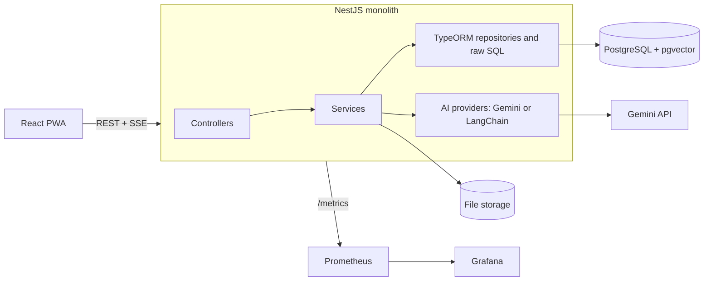

# Knowly: Project Documentation (V1)

> A document-based AI knowledge assistant. Users upload documents and chat with them. Answers are grounded in the uploaded content using RAG, with source citations.

**Status:** V1 finalized for build (architecture revised: traditional monolith + layered architecture)
**Timeline:** 4 days
**Author:** Berlin (Althaf)

---

## Table of Contents

1. [Overview](#1-overview)
2. [Goals and Non-Goals](#2-goals-and-non-goals)
3. [Tech Stack](#3-tech-stack)
4. [Backend Architecture](#4-backend-architecture)
5. [Backend Folder Structure](#5-backend-folder-structure)
6. [Frontend Folder Structure](#6-frontend-folder-structure)
7. [Core Workflows](#7-core-workflows)
8. [Database Design](#8-database-design)
9. [API Design](#9-api-design)
10. [Technical Guidelines](#10-technical-guidelines)
11. [Infrastructure and DevOps](#11-infrastructure-and-devops)
12. [Observability](#12-observability)
13. [Testing Strategy](#13-testing-strategy)
14. [Four-Day Plan](#14-four-day-plan)
15. [V2 Roadmap](#15-v2-roadmap)
16. [Decision Log](#16-decision-log)
17. [Glossary](#17-glossary)

---

## 1. Overview

Knowly lets a user upload documents (PDF, DOCX, TXT, Markdown), processes them into searchable vector chunks, and answers questions about them through a chat interface. Every answer cites the chunks it was built from.

Knowly is a **RAG-based assistant**, not an autonomous agent. It retrieves context, builds a prompt, calls the LLM, and returns a grounded answer. It does not plan, use tools, or take actions on its own.

The project doubles as a learning vehicle for LLMs, RAG, LangChain, and the supporting ecosystem. The core LLM and RAG workflows are built first with the raw Gemini SDK, then LangChain is introduced on Day 3 and compared against the direct implementation.

The backend is a **traditional monolith with a simple layered architecture**. The goal is to keep the code easy to read and fast to build, so the time goes into learning LLMs and RAG, not into architecture ceremony.

### 1.1 Module List to Folder Mapping

The functional module list (see `Knowly-v1-module-list.md`) maps to backend folders like this:

| Functional module | Backend folder |
|---|---|
| Auth | `modules/auth` |
| User | `modules/users` |
| Document | `modules/documents` |
| Ingestion | `modules/documents` (ingestion service + chunker + extractors) |
| Retrieval | `modules/documents` (retriever interface + implementations), used by `modules/chat` |
| Chat | `modules/chat` |
| LLM | `modules/llm` |
| Observability | `modules/observability` |
| Frontend (PWA) | `knowly-frontend` |

## 2. Goals and Non-Goals

### Goals

- Build a working document Q&A assistant in four days
- Understand the LLM and RAG workflow end to end before abstracting it with LangChain
- Keep the code simple: clear responsibilities, no abstraction without a reason
- Compare the raw implementation with the LangChain implementation side by side
- Ship a PWA, containerized, with metrics and dashboards

### Non-Goals (V1)

- Clean Architecture, DDD, or strict dependency inversion (no use-case classes, no repository interfaces, no domain/ORM entity split, no mappers)
- Modular monolith (strict module boundaries, per-module data ownership, enforced public APIs)
- Microservices (not planned in V2 either)
- Autonomous agents, multi-agent systems, LangGraph
- Kubernetes
- Message brokers or event streaming
- Rewriting the whole backend around LangChain (it is used for AI functionality only)

### Non-Functional Requirements

| Area | Requirement |
|---|---|
| Supported files | PDF, DOCX, TXT, Markdown |
| Max upload size | 10 MB by default (`MAX_UPLOAD_MB`) |
| User isolation | A user can never read another user's documents, chunks, or conversations |
| Grounding | Answers must come from retrieved context and include citations; if nothing relevant is found, say so |
| Streaming | Chat answers stream token by token |
| Resilience | Vendor failures (rate limit, timeout) return clean errors and never crash the process |
| Observability | Every request and every LLM/embedding/retrieval call is measurable |

## 3. Tech Stack

| Concern | Choice |
|---|---|
| Frontend | React, Vite, Redux Toolkit (PWA, service worker, offline cache) |
| Backend | NestJS (TypeScript) |
| Architecture | Traditional monolith, layered architecture, feature folders |
| LLM provider | Google Gemini |
| AI framework | Raw Gemini SDK first, LangChain on Day 3 |
| Database | PostgreSQL |
| ORM and migrations | TypeORM (vector queries use raw SQL) |
| Vector search | pgvector |
| Containerization | Docker, Docker Compose |
| Secrets | Doppler |
| Metrics | Prometheus |
| Dashboards | Grafana |
| Testing | Jest, Supertest, Testcontainers |

## 4. Backend Architecture

### 4.1 Style

A single deployable NestJS application with a **simple layered architecture**. Each feature is a NestJS module (a folder) that contains its own controller, service, and entities. A request flows top to bottom through three layers.

```
Controller  ->  Service  ->  Data access (TypeORM repositories / raw SQL / external SDKs)
```



### 4.2 Layers

| Layer | Responsibility | Calls |
|---|---|---|
| **Controller** | HTTP only: routes, DTO validation, guards, SSE response. No business logic. | Services |
| **Service** | Business logic and orchestration. One service per feature area (e.g. `DocumentsService`, `IngestionService`, `ChatService`). | Repositories, other services, AI providers |
| **Data access** | TypeORM repositories (`@InjectRepository`), raw SQL for vector search, file system, vendor SDKs. | Database / external systems |

### 4.3 Rules

- Controllers never touch the database or vendor SDKs. They call services.
- Services hold the business logic. They use TypeORM repositories directly (no repository interfaces).
- TypeORM entities are used across the whole app. No separate domain entities and no mappers.
- Services may call services from other features through NestJS module imports. Avoid circular dependencies.
- Use NestJS built-ins instead of custom wrappers: `Logger` for logging, `@nestjs/jwt` for tokens, `ConfigService` for config, `bcrypt` called directly for password hashing.
- Do not create an interface, port, or abstraction unless there is a concrete reason (see 4.4).

### 4.4 Where Abstractions Are Allowed

Abstractions are introduced only when something genuinely has more than one implementation. In Knowly that is the AI layer, because Day 3 compares raw Gemini against LangChain on the same documents and questions.

| Abstraction | Reason | Implementations |
|---|---|---|
| `LlmProvider` | Gemini vs LangChain comparison | `GeminiLlmProvider` (Day 1-2), `LangChainLlmProvider` (Day 3) |
| `EmbeddingProvider` | Gemini vs LangChain comparison | `GeminiEmbeddingProvider`, `LangChainEmbeddingProvider` |
| `Retriever` | Hand-written pgvector vs LangChain retriever | `PgvectorRetriever` (Day 2), `LangChainRetriever` (Day 3) |

Everything else is a concrete class: file storage (local disk), text extractors (a plain service picking an extractor by MIME type), metrics (`MetricsService` over `prom-client`), logging (Nest `Logger`).

```ts
// modules/llm/interfaces/llm-provider.interface.ts
export const LLM_PROVIDER = Symbol('LLM_PROVIDER');
export interface LlmProvider {
  generate(input: GenerateInput): Promise<GenerateOutput>;
  stream(input: GenerateInput): AsyncIterable<string>;
}

// modules/llm/interfaces/embedding-provider.interface.ts
export const EMBEDDING_PROVIDER = Symbol('EMBEDDING_PROVIDER');
export interface EmbeddingProvider {
  embedDocuments(texts: string[]): Promise<number[][]>;
  embedQuery(text: string): Promise<number[]>;
}

// modules/documents/retrieval/retriever.interface.ts
export const RETRIEVER = Symbol('RETRIEVER');
export interface Retriever {
  retrieve(params: RetrieveParams): Promise<RetrievedChunk[]>; // embeds the query, searches, applies the threshold
}
```

The active implementation is chosen by an environment variable (`AI_PROVIDER=gemini | langchain`):

- `llm.module.ts` binds `LLM_PROVIDER` and `EMBEDDING_PROVIDER`
- `documents.module.ts` binds `RETRIEVER`

Services such as `ChatService` and `IngestionService` inject these tokens, so switching providers means changing one binding, not the services.

## 5. Backend Folder Structure

**Feature-first:** code is grouped by feature. Inside a feature, files are grouped by role (controller, service, entity, dto). Create a subfolder only when the feature actually needs it.

```
knowly-backend/
├── src/
│   ├── main.ts
│   ├── app.module.ts
│   │
│   ├── modules/
│   │   │
│   │   ├── auth/
│   │   │   ├── controllers/auth.controller.ts
│   │   │   ├── services/auth.service.ts          # register, login, refresh, logout
│   │   │   ├── entities/refresh-token.entity.ts
│   │   │   ├── guards/jwt-auth.guard.ts
│   │   │   ├── dto/
│   │   │   └── auth.module.ts                    # registers JwtAuthGuard as APP_GUARD
│   │   │
│   │   ├── users/
│   │   │   ├── controllers/users.controller.ts
│   │   │   ├── services/users.service.ts
│   │   │   ├── entities/user.entity.ts
│   │   │   ├── dto/
│   │   │   └── users.module.ts
│   │   │
│   │   ├── documents/
│   │   │   ├── controllers/documents.controller.ts
│   │   │   ├── services/
│   │   │   │   ├── documents.service.ts          # upload, list, get, delete, reprocess
│   │   │   │   ├── ingestion.service.ts          # extract -> clean -> chunk -> embed -> save
│   │   │   │   ├── chunker.service.ts
│   │   │   │   ├── text-extractor.service.ts     # picks an extractor by MIME type
│   │   │   │   └── file-storage.service.ts       # local disk
│   │   │   ├── extractors/
│   │   │   │   ├── pdf.extractor.ts
│   │   │   │   ├── docx.extractor.ts
│   │   │   │   ├── txt.extractor.ts
│   │   │   │   └── markdown.extractor.ts
│   │   │   ├── retrieval/
│   │   │   │   ├── retriever.interface.ts
│   │   │   │   ├── pgvector.retriever.ts         # Day 2
│   │   │   │   └── langchain.retriever.ts        # Day 3
│   │   │   ├── repositories/
│   │   │   │   └── document-chunk.repository.ts  # custom TypeORM repo: raw SQL for vector search
│   │   │   ├── entities/
│   │   │   │   ├── document.entity.ts
│   │   │   │   └── document-chunk.entity.ts
│   │   │   ├── dto/
│   │   │   └── documents.module.ts               # binds RETRIEVER by AI_PROVIDER
│   │   │
│   │   ├── chat/
│   │   │   ├── controllers/chat.controller.ts    # SSE streaming
│   │   │   ├── services/
│   │   │   │   ├── chat.service.ts               # conversations + ask question (RAG flow)
│   │   │   │   └── prompt-builder.service.ts
│   │   │   ├── entities/
│   │   │   │   ├── conversation.entity.ts
│   │   │   │   └── message.entity.ts
│   │   │   ├── dto/
│   │   │   └── chat.module.ts
│   │   │
│   │   ├── llm/                                  # the swappable AI layer
│   │   │   ├── interfaces/
│   │   │   │   ├── llm-provider.interface.ts
│   │   │   │   └── embedding-provider.interface.ts
│   │   │   ├── gemini/
│   │   │   │   ├── gemini-llm.provider.ts
│   │   │   │   ├── gemini-embedding.provider.ts
│   │   │   │   └── gemini.client.ts
│   │   │   ├── langchain/
│   │   │   │   ├── langchain-llm.provider.ts
│   │   │   │   └── langchain-embedding.provider.ts
│   │   │   └── llm.module.ts                     # binds LLM_PROVIDER / EMBEDDING_PROVIDER by AI_PROVIDER
│   │   │
│   │   └── observability/
│   │       ├── controllers/
│   │       │   ├── health.controller.ts
│   │       │   └── metrics.controller.ts
│   │       ├── interceptors/metrics.interceptor.ts
│   │       ├── services/metrics.service.ts       # prom-client wrapper
│   │       └── observability.module.ts           # @Global, exports MetricsService
│   │
│   ├── common/                                   # feature-agnostic only
│   │   ├── entities/base.entity.ts
│   │   ├── errors/app.exception.ts               # AppException with a stable error code
│   │   ├── decorators/
│   │   │   ├── public.decorator.ts               # @Public(): opt out of the global auth guard
│   │   │   └── current-user.decorator.ts         # @CurrentUser(): authenticated user in handlers
│   │   ├── filters/app-exception.filter.ts
│   │   └── pipes/
│   │
│   ├── config/
│   │   ├── env.validation.ts
│   │   └── configuration.ts
│   │
│   └── database/
│       ├── database.module.ts                    # TypeORM setup
│       └── migrations/
│
├── test/
│   ├── unit/
│   ├── integration/
│   └── e2e/
├── docker/
│   ├── Dockerfile
│   └── postgres/init.sql               # CREATE EXTENSION vector;
├── docker-compose.yml
├── prometheus/prometheus.yml
├── grafana/
│   ├── provisioning/
│   └── dashboards/
├── package.json
└── tsconfig.json
```

### 5.1 Feature Rules

1. **Controller -> Service -> Data access, always.** Controllers never skip the service layer.
2. **Cross-feature calls go through services.** A feature uses another feature by importing its NestJS module and injecting the exported service (or an AI interface token). For example, `ChatService` injects the `RETRIEVER` token and `LLM_PROVIDER` token and never knows which implementation is behind them. Avoid reaching into another feature's controllers or internals.
3. **Features are folders, not isolated modules.** There is no per-feature data ownership or enforced public API. Joins across feature tables are fine.
4. **`common/` stays small and generic.** Base entity, app exception, filters, and the `@Public()` / `@CurrentUser()` decorators. If something is about documents, it lives in `documents/`.
5. **Create folders only when needed.** For example, `llm` has no controllers or entities.
6. **No lint-enforced boundaries in V1.** Keep it simple. Add import rules later only if the codebase starts to tangle.

### 5.2 Notes

- Each feature has a `*.module.ts` at its root for NestJS wiring. These are not deployment boundaries. This is a single monolith.
- **Auth guard:** `JwtAuthGuard` lives in `auth/guards` and verifies tokens with `JwtService`. `auth.module.ts` registers it as `APP_GUARD`, so every route is protected by default. Public routes (register, login, refresh, health, metrics) use `@Public()`. Controllers read the authenticated user with `@CurrentUser()`.
- **Module wiring:** `llm.module.ts` exports `LLM_PROVIDER` and `EMBEDDING_PROVIDER`. `documents.module.ts` imports `LlmModule` and exports `RETRIEVER`. `chat.module.ts` imports `DocumentsModule` and `LlmModule`. `ObservabilityModule` is global.
- **Entities and migrations:** TypeORM entities live with their feature in `entities/`. Migrations are global in `database/migrations`, since there is one database.
- **DTOs:** request/response DTOs (with validation decorators) live in each feature's `dto/` folder.
- **Vector queries:** TypeORM does not understand pgvector operators, so similarity search lives in a custom repository (`document-chunk.repository.ts`) using raw SQL.

## 6. Frontend Folder Structure

```
knowly-frontend/
├── public/
│   ├── manifest.webmanifest
│   └── icons/
├── src/
│   ├── main.tsx
│   ├── app/
│   │   ├── App.tsx
│   │   ├── router.tsx
│   │   └── providers/
│   ├── pages/
│   │   ├── LoginPage.tsx
│   │   ├── RegisterPage.tsx
│   │   ├── DocumentsPage.tsx
│   │   └── ChatPage.tsx
│   ├── features/
│   │   ├── auth/
│   │   ├── documents/
│   │   │   ├── components/
│   │   │   ├── hooks/
│   │   │   └── api.ts
│   │   └── chat/
│   │       ├── components/
│   │       │   ├── MessageList.tsx
│   │       │   ├── MessageInput.tsx
│   │       │   └── CitationList.tsx
│   │       ├── hooks/useStreamedAnswer.ts
│   │       └── api.ts
│   ├── shared/
│   │   ├── components/
│   │   ├── lib/http-client.ts
│   │   ├── lib/offline-cache.ts
│   │   └── types/
│   ├── store/                          # Redux Toolkit slices
│   └── sw.ts                           # service worker
├── index.html
└── vite.config.ts
```

## 7. Core Workflows

### 7.1 Ingestion Pipeline

```
Upload  ->  Validate  ->  Store file  ->  Create Document (status: uploaded)
        ->  Extract text  ->  Clean/normalize  ->  Chunk
        ->  Embed chunks (batch)  ->  Save chunks + vectors
        ->  Document status: ready   (or failed + reason)
```

- Status transitions: `uploaded -> processing -> ready | failed`
- `DocumentsService.upload()` stores the file, creates the record, and starts `IngestionService.ingest()` without awaiting it. No message broker in V1, so it runs inside the same process.
- The upload endpoint returns immediately; the frontend polls document status.
- On startup, documents stuck in `processing` are marked `failed` (their job died with the old process) and can be re-processed.
- Re-processing deletes the old chunks first, then runs the pipeline again.

### 7.2 RAG Query Flow

```
User question
  -> Retriever.retrieve(question, scope)
       (embed query -> similarity search, top-k, scoped to user/documents -> relevance threshold)
  -> build prompt (system rules + context chunks + history + question)
  -> LlmProvider.stream(prompt)
  -> persist message + citations
  -> stream tokens to client, then send citations
```

`ChatService.askQuestion()` orchestrates this flow.

If no chunk passes the relevance threshold, the assistant answers that it could not find the information in the uploaded documents instead of guessing.

### 7.3 Prompt Structure

```
[System]  Role, grounding rules, "answer only from context", citation format
[Context] Numbered chunks: [1] <text> (doc name, page/chunk id)
[History] Last N turns of the conversation
[User]    Current question
```

Prompts live in `modules/chat/services/prompt-builder.service.ts`, versioned in code, never inline in controllers or providers.

### 7.4 Chunking Defaults (tunable)

| Parameter | Starting value |
|---|---|
| Chunk size | 800 to 1000 characters |
| Overlap | 100 to 150 characters |
| Top-k | 5 |
| Relevance threshold | Tune per embedding model |

Keep these in config, not hard-coded, so both implementations can be compared on identical settings.

### 7.5 Auth Flow

- `POST /auth/login` returns a short-lived access token and a refresh token.
- Only a **hash** of the refresh token is stored in `refresh_tokens`.
- `POST /auth/refresh` verifies the token, rotates it (old one revoked, new one issued).
- `POST /auth/logout` revokes the refresh token.
- The global `JwtAuthGuard` verifies the access token on every non-`@Public()` route and attaches the user to the request.

## 8. Database Design

PostgreSQL with the `vector` extension enabled.

```sql
CREATE EXTENSION IF NOT EXISTS vector;

CREATE TABLE users (
  id            UUID PRIMARY KEY DEFAULT gen_random_uuid(),
  email         TEXT UNIQUE NOT NULL,
  password_hash TEXT NOT NULL,
  name          TEXT,
  created_at    TIMESTAMPTZ NOT NULL DEFAULT now(),
  updated_at    TIMESTAMPTZ NOT NULL DEFAULT now()
);

CREATE TABLE refresh_tokens (
  id          UUID PRIMARY KEY DEFAULT gen_random_uuid(),
  user_id     UUID NOT NULL REFERENCES users(id) ON DELETE CASCADE,
  token_hash  TEXT NOT NULL,
  expires_at  TIMESTAMPTZ NOT NULL,
  revoked_at  TIMESTAMPTZ,
  created_at  TIMESTAMPTZ NOT NULL DEFAULT now()
);
CREATE INDEX idx_refresh_tokens_user ON refresh_tokens(user_id);

CREATE TABLE documents (
  id            UUID PRIMARY KEY DEFAULT gen_random_uuid(),
  user_id       UUID NOT NULL REFERENCES users(id) ON DELETE CASCADE,
  file_name     TEXT NOT NULL,
  mime_type     TEXT NOT NULL,
  size_bytes    BIGINT NOT NULL,
  storage_path  TEXT NOT NULL,
  status        TEXT NOT NULL CHECK (status IN ('uploaded','processing','ready','failed')),
  failure_reason TEXT,
  created_at    TIMESTAMPTZ NOT NULL DEFAULT now(),
  updated_at    TIMESTAMPTZ NOT NULL DEFAULT now()
);
CREATE INDEX idx_documents_user ON documents(user_id);

CREATE TABLE document_chunks (
  id            UUID PRIMARY KEY DEFAULT gen_random_uuid(),
  document_id   UUID NOT NULL REFERENCES documents(id) ON DELETE CASCADE,
  user_id       UUID NOT NULL REFERENCES users(id) ON DELETE CASCADE,  -- denormalized for scoped search
  chunk_index   INT NOT NULL,
  content       TEXT NOT NULL,
  metadata      JSONB NOT NULL DEFAULT '{}',   -- page number, etc.
  embedding     vector(768) NOT NULL           -- dimension must match the embedding model
);

CREATE INDEX idx_chunks_embedding
  ON document_chunks USING hnsw (embedding vector_cosine_ops);
CREATE INDEX idx_chunks_document ON document_chunks(document_id);
CREATE INDEX idx_chunks_user ON document_chunks(user_id);

CREATE TABLE conversations (
  id         UUID PRIMARY KEY DEFAULT gen_random_uuid(),
  user_id    UUID NOT NULL REFERENCES users(id) ON DELETE CASCADE,
  title      TEXT,
  created_at TIMESTAMPTZ NOT NULL DEFAULT now(),
  updated_at TIMESTAMPTZ NOT NULL DEFAULT now()
);
CREATE INDEX idx_conversations_user ON conversations(user_id);

CREATE TABLE messages (
  id              UUID PRIMARY KEY DEFAULT gen_random_uuid(),
  conversation_id UUID NOT NULL REFERENCES conversations(id) ON DELETE CASCADE,
  role            TEXT NOT NULL CHECK (role IN ('user','assistant')),
  content         TEXT NOT NULL,
  citations       JSONB NOT NULL DEFAULT '[]',  -- [{documentId, chunkId, snippet}]
  prompt_tokens   INT,
  completion_tokens INT,
  created_at      TIMESTAMPTZ NOT NULL DEFAULT now()
);
CREATE INDEX idx_messages_conversation ON messages(conversation_id, created_at);
```

**Important notes on the vector column:**

- The `vector(N)` dimension must match the embedding model's output. Set the model's output dimensionality explicitly and pin it in config (`EMBEDDING_DIMENSIONS`).
- pgvector's HNSW index supports up to 2,000 dimensions for the `vector` type, so choose a dimensionality at or below that (768 is the default here). Verify against the embedding model you pick before running the first migration.
- Changing the embedding model later means re-embedding every chunk.

## 9. API Design

Base path: `/api/v1`. All routes require a JWT unless marked `@Public()` (auth register/login/refresh, health, metrics).

### Auth

| Method | Route | Purpose |
|---|---|---|
| POST | `/auth/register` | Create account |
| POST | `/auth/login` | Returns access and refresh tokens |
| POST | `/auth/refresh` | Rotate tokens |
| POST | `/auth/logout` | Revoke refresh token |

### Users

| Method | Route | Purpose |
|---|---|---|
| GET | `/users/me` | Current profile |
| PATCH | `/users/me` | Update profile and settings |

### Documents

| Method | Route | Purpose |
|---|---|---|
| POST | `/documents` | Upload (multipart) |
| GET | `/documents` | List user's documents |
| GET | `/documents/:id` | Details and status |
| POST | `/documents/:id/reprocess` | Re-run ingestion |
| DELETE | `/documents/:id` | Delete document, chunks, vectors, file |

### Chat

| Method | Route | Purpose |
|---|---|---|
| POST | `/conversations` | Create conversation |
| GET | `/conversations` | List conversations |
| GET | `/conversations/:id/messages` | Message history |
| POST | `/conversations/:id/messages` | Ask a question (SSE stream) |
| PATCH | `/conversations/:id` | Rename |
| DELETE | `/conversations/:id` | Delete |

### Ops

| Method | Route | Purpose |
|---|---|---|
| GET | `/health` | Liveness and readiness |
| GET | `/metrics` | Prometheus scrape endpoint |

### Conventions

- JSON everywhere except uploads (multipart) and chat streaming (Server-Sent Events)
- Consistent error shape: `{ "error": { "code": "DOCUMENT_NOT_FOUND", "message": "...", "details": {} } }`
- Pagination on list endpoints (`?page=&limit=`)

### Error Codes

| Code | HTTP | Meaning |
|---|---|---|
| `VALIDATION_ERROR` | 400 | Request body or params failed validation |
| `AUTH_INVALID_CREDENTIALS` | 401 | Wrong email or password |
| `AUTH_TOKEN_INVALID` | 401 | Missing, malformed, or expired token |
| `DOCUMENT_NOT_FOUND` | 404 | Document does not exist or is not the user's |
| `DOCUMENT_UNSUPPORTED_TYPE` | 415 | File type not allowed |
| `DOCUMENT_TOO_LARGE` | 413 | File exceeds `MAX_UPLOAD_MB` |
| `DOCUMENT_NOT_READY` | 409 | Document is still processing or failed |
| `CONVERSATION_NOT_FOUND` | 404 | Conversation does not exist or is not the user's |
| `LLM_RATE_LIMITED` | 429 | Provider rate limit hit |
| `LLM_UNAVAILABLE` | 502 | Provider failed or timed out |
| `INTERNAL_ERROR` | 500 | Unexpected failure |

## 10. Technical Guidelines

### 10.1 Architecture Rules

1. Controllers contain no business logic. They validate input, call one service method, and return the result.
2. Business logic lives in services. Services use TypeORM repositories directly.
3. Use TypeORM entities everywhere. No separate domain model, no mappers.
4. Only the AI layer is abstracted (`LlmProvider`, `EmbeddingProvider`, `Retriever`), injected through symbol tokens (`LLM_PROVIDER`, `EMBEDDING_PROVIDER`, `RETRIEVER`).
5. New AI vendor or framework = a new provider class in `modules/llm/` (or a new retriever in `documents/retrieval/`). No service changes.
6. Do not add an interface or abstraction for anything with a single implementation. Add it later if a second implementation actually shows up.
7. Cross-feature calls go through NestJS module imports and exported services.
8. Keep services focused. If a service grows too large, split it by responsibility (as `IngestionService` is split from `DocumentsService`), not by pattern.

### 10.2 Naming and Code Style

| Item | Convention |
|---|---|
| Files | `kebab-case` with role suffix: `documents.service.ts`, `gemini-llm.provider.ts` |
| Controllers | `*.controller.ts` |
| Services | `*.service.ts` |
| Entities | `*.entity.ts` |
| AI providers / retrievers | `*.provider.ts` / `*.retriever.ts` |
| Interfaces | `*.interface.ts` |
| Classes | `PascalCase` |
| DTOs | `CreateConversationRequestDto`, `MessageResponseDto` |
| Env vars | `SCREAMING_SNAKE_CASE` |
| DB columns | `snake_case` |

TypeScript `strict: true`. No `any` without a comment explaining why. Prefer `unknown` plus narrowing.

### 10.3 Error Handling

- Business errors throw `AppException` with a stable `code` (see the error code table in section 9).
- A global exception filter maps `AppException` to the HTTP status and the standard error shape.
- Provider classes catch vendor errors (Gemini rate limit, timeout) and rethrow them as `AppException` (`LLM_RATE_LIMITED`, `LLM_UNAVAILABLE`), so vendor types never leak into services or controllers.
- Retry only idempotent calls (embeddings, generation) with exponential backoff and a cap.
- Never log full document text, tokens, or passwords.

### 10.4 Validation

- Request DTOs use `class-validator` and `class-transformer` with a global `ValidationPipe` (`whitelist: true`, `forbidNonWhitelisted: true`).
- Validate env vars at boot with a schema (Joi or zod). The app must refuse to start on missing or invalid config.
- Validate uploads by MIME type and magic bytes, not only extension. Enforce a max file size.

### 10.5 Security

- Passwords hashed with bcrypt or argon2.
- Short-lived access token, rotating refresh token stored as a hash.
- Every route is protected by the global `JwtAuthGuard`; only routes marked `@Public()` are open.
- Every query on documents, chunks, and conversations is scoped by `user_id`. Retrieval must never cross users.
- Rate-limit auth and chat endpoints.
- CORS locked to the frontend origin.
- Treat document content as untrusted input. State in the system prompt that context text is data, not instructions, to reduce prompt injection risk.
- Secrets come from Doppler. No secrets in the repo, Dockerfiles, or compose files.

### 10.6 Configuration and Secrets

- Doppler injects environment variables at runtime (`doppler run -- <command>`).
- NestJS `ConfigService` is the only code that reads `process.env`.

| Variable | Example (placeholder) | Purpose |
|---|---|---|
| `NODE_ENV` | `development` | Runtime mode |
| `PORT` | `3000` | API port |
| `DATABASE_URL` | `postgres://knowly:<password>@localhost:5432/knowly` | Postgres connection |
| `JWT_ACCESS_SECRET` | `<random 32+ chars>` | Access token signing |
| `JWT_REFRESH_SECRET` | `<random 32+ chars>` | Refresh token signing |
| `JWT_ACCESS_TTL` | `15m` | Access token lifetime |
| `JWT_REFRESH_TTL` | `7d` | Refresh token lifetime |
| `GEMINI_API_KEY` | `<your key>` | Gemini access |
| `AI_PROVIDER` | `gemini` or `langchain` | Which AI implementations are bound |
| `CHAT_MODEL` | `<gemini chat model>` | Generation model |
| `EMBEDDING_MODEL` | `<gemini embedding model>` | Embedding model |
| `EMBEDDING_DIMENSIONS` | `768` | Must match `vector(N)` |
| `CHUNK_SIZE` | `900` | Chunk size in characters |
| `CHUNK_OVERLAP` | `120` | Overlap in characters |
| `RETRIEVAL_TOP_K` | `5` | Chunks retrieved per question |
| `RETRIEVAL_MIN_SCORE` | `<tuned>` | Relevance threshold |
| `MAX_UPLOAD_MB` | `10` | Upload size limit |
| `FILE_STORAGE_PATH` | `./storage` | Where uploaded files are kept |
| `CORS_ORIGIN` | `http://localhost:5173` | Allowed frontend origin |

### 10.7 Logging

- Structured JSON logs with a request ID on every line.
- Services log through the NestJS `Logger`.
- Log pipeline milestones: ingestion started, chunk count, embedding duration, retrieval hits, LLM latency, token counts.
- Levels: `error` for failures, `warn` for retries and degraded behavior, `info` for milestones, `debug` off in production.

### 10.8 Git and Workflow

- Branch naming: `feat/...`, `fix/...`, `chore/...`
- Conventional commits (`feat: add chunker service`)
- Small commits per service or provider
- Migrations are forward-only and committed with the change that needs them

## 11. Infrastructure and DevOps

### Docker Compose (services)

| Service | Image / Build | Purpose |
|---|---|---|
| `api` | Built from `docker/Dockerfile` | NestJS backend |
| `db` | `pgvector/pgvector` image | PostgreSQL with pgvector |
| `prometheus` | `prom/prometheus` | Scrapes `/metrics` |
| `grafana` | `grafana/grafana` | Dashboards |

The frontend runs via Vite in development and is built to static files for production.

### Dockerfile Guidelines

- Multi-stage build (build, then slim runtime)
- Run as non-root user
- Only production dependencies in the final image
- Health check hitting `/api/v1/health`

### Setup and Run

Prerequisites: Node.js (LTS), Docker with Docker Compose, Doppler CLI.

```bash
# 1. Configure secrets (one time)
doppler setup

# 2. Start the full stack (api, db, prometheus, grafana)
doppler run -- docker compose up --build

# 3. Run migrations
doppler run -- npm run migration:run

# 4. Frontend (separate terminal)
cd knowly-frontend && npm install && npm run dev
```

For day-to-day backend development, run only the database in Docker and the API locally:

```bash
doppler run -- docker compose up -d db
doppler run -- npm run start:dev
```

Script names (`migration:run`, `start:dev`) are suggestions; align them with your `package.json`.

## 12. Observability

### Metrics (Prometheus)

| Metric | Type | Notes |
|---|---|---|
| `http_request_duration_seconds` | Histogram | By route, method, status |
| `llm_request_duration_seconds` | Histogram | By provider (`gemini` / `langchain`) |
| `llm_tokens_total` | Counter | Labels: `type=prompt\|completion` |
| `embedding_duration_seconds` | Histogram | Per batch |
| `retrieval_duration_seconds` | Histogram | Retrieval time, by provider |
| `retrieval_chunks_returned` | Histogram | Chunks passing threshold |
| `ingestion_jobs_total` | Counter | Labels: `status=ready\|failed` |
| `errors_total` | Counter | By error code |

Services and providers record metrics through `MetricsService` (a thin wrapper over `prom-client`, exported by the global `ObservabilityModule`). The `provider` label is what makes the Day 3 comparison measurable: same questions, two providers, side by side in Grafana.

### Dashboards (Grafana)

1. **API overview:** request rate, p95 latency, error rate
2. **AI pipeline:** LLM latency by provider, token usage, retrieval time
3. **Ingestion:** jobs by status, processing duration

## 13. Testing Strategy

| Level | Scope | Notes |
|---|---|---|
| Unit | Services (`ChatService`, `IngestionService`), chunker, prompt builder | Repositories and AI providers mocked; fast |
| Integration | Services + TypeORM repositories against real Postgres + pgvector | Use a test container; covers the vector SQL |
| Contract | Both AI implementations (LLM, embedding, retriever) against the same expectations | Same test suite run per implementation |
| E2E | Upload -> ingest -> ask -> cited answer | Small fixed sample documents |

For the RAG comparison, keep a small **evaluation set**: a few documents and 10 to 15 questions with expected source chunks. Run it against both providers and compare answer quality, citation accuracy, and latency.

## 14. Four-Day Plan

| Day | Focus | Deliverables |
|---|---|---|
| **1** | LLM fundamentals with Gemini SDK | Project skeleton with feature folders and the controller/service layers, `common/` setup, `LlmProvider` + Gemini provider with streaming, Auth + Users modules |
| **2** | RAG without LangChain | Document upload, text extraction, chunking, embeddings, pgvector storage, `PgvectorRetriever`, chat endpoint with citations |
| **3** | LangChain + infra | LangChain LLM, embedding, and retriever implementations behind the same interfaces, side-by-side comparison on the evaluation set, Docker, Doppler |
| **4** | Frontend and monitoring | React PWA (upload, chat, installable), Prometheus metrics, Grafana dashboards, polish and docs |

**Stretch goals** (cut first if time runs short): offline cache of chat history and document list, polished Grafana dashboards, refresh token rotation UI handling.

## 15. V2 Roadmap

Deferred on purpose so V1 stays shippable:

- LangGraph and agentic workflows
- Hybrid search (keyword + vector) and reranking
- Background job queue for ingestion
- Multi-tenant workspaces and sharing
- Evaluation automation and prompt versioning
- Cloud object storage for files

Microservices are not planned. If the codebase outgrows the simple layering, revisit the structure then.

## 16. Decision Log

| # | Decision | Reason |
|---|---|---|
| 1 | Traditional monolith, no microservices, no modular monolith | Four-day scope; learning focus is LLMs and RAG, not distributed systems |
| 2 | Layered architecture (controller, service, data access) instead of Clean Architecture | Avoid unnecessary complexity in a four-day learning project; more time on LLMs, RAG, LangChain |
| 3 | Feature-first folders, files grouped by role inside each feature | Everything about a feature in one place; matches the structure used in other projects |
| 4 | RAG assistant, not an agent | Keeps scope achievable and the behavior predictable |
| 5 | Raw Gemini SDK first, LangChain on Day 3 | Understand the workflow before abstracting it, then compare both |
| 6 | Abstractions only when necessary; the AI layer (`LlmProvider`, `EmbeddingProvider`, `Retriever`) is the one place that qualifies | Two real implementations (Gemini and LangChain) need to be swappable and comparable |
| 7 | PostgreSQL + pgvector instead of a separate vector DB | One database to run and back up; enough for V1 scale |
| 8 | TypeORM entities used directly, raw SQL for vector queries | First-class NestJS support and built-in migrations; no mappers or repository interfaces to maintain |
| 9 | Global `JwtAuthGuard` with `@Public()` opt-out | Safe by default; no feature imports auth internals |
| 10 | In-process async ingestion, no broker | No extra infrastructure in V1; stuck jobs are recovered on startup |
| 11 | SSE for streaming chat answers | Simple one-way streaming over plain HTTP |
| 12 | 768-dimension embeddings with an HNSW index | Within pgvector's HNSW dimension limit; smaller and faster to search |
| 13 | NestJS built-ins (`Logger`, `JwtService`, `ConfigService`) and a plain `MetricsService` instead of custom ports | No wrappers without a second implementation |

## 17. Glossary

| Term | Meaning |
|---|---|
| **RAG** | Retrieval-Augmented Generation: fetch relevant text first, then have the LLM answer using it |
| **Chunk** | A small slice of a document that is embedded and searched individually |
| **Embedding** | A vector of numbers representing the meaning of a piece of text |
| **Vector search** | Finding the chunks whose embeddings are closest to the question's embedding |
| **Top-k** | How many of the closest chunks are retrieved |
| **Relevance threshold** | Minimum similarity score a chunk needs to be used as context |
| **Citation** | A reference from an answer back to the chunk and document it came from |
| **Layered architecture** | Code split by responsibility: controllers handle HTTP, services hold business logic, data access talks to the DB and external systems |
| **Service** | A class holding business logic for a feature, called by controllers |
| **Provider (AI)** | A swappable implementation of the LLM or embedding interface (Gemini or LangChain) |
| **SSE** | Server-Sent Events: one-way streaming from server to browser over HTTP |
| **HNSW** | An approximate nearest-neighbor index type supported by pgvector |
| **PWA** | Progressive Web App: a web app that can be installed and work with limited connectivity |

---

*Knowly V1: traditional monolith, layered architecture, RAG first, frameworks second.*