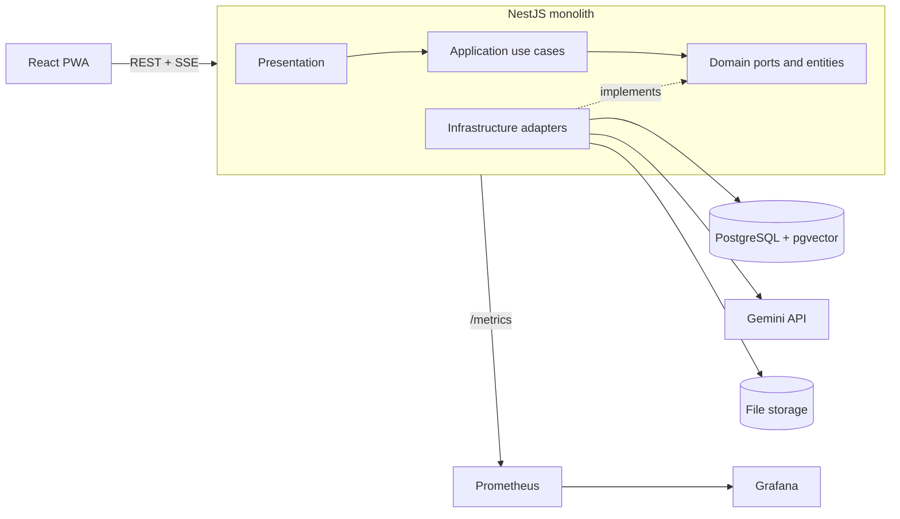

# PolkaDocs: Project Documentation (V1)

> A document-based AI knowledge assistant. Users upload documents and chat with them. Answers are grounded in the uploaded content using RAG, with source citations.

**Status:** V1 finalized for build
**Timeline:** 4 days
**Author:** Berlin (Althaf)

---

## Table of Contents

1. [Overview](#1-overview)
2. [Goals and Non-Goals](#2-goals-and-non-goals)
3. [Tech Stack](#3-tech-stack)
4. [Backend Architecture](#4-backend-architecture)
5. [Backend Folder Structure](#5-backend-folder-structure)
6. [Frontend Folder Structure](#6-frontend-folder-structure)
7. [Core Workflows](#7-core-workflows)
8. [Database Design](#8-database-design)
9. [API Design](#9-api-design)
10. [Technical Guidelines](#10-technical-guidelines)
11. [Infrastructure and DevOps](#11-infrastructure-and-devops)
12. [Observability](#12-observability)
13. [Testing Strategy](#13-testing-strategy)
14. [Four-Day Plan](#14-four-day-plan)
15. [V2 Roadmap](#15-v2-roadmap)
16. [Decision Log](#16-decision-log)
17. [Glossary](#17-glossary)

---

## 1. Overview

PolkaDocs lets a user upload documents (PDF, DOCX, TXT, Markdown), processes them into searchable vector chunks, and answers questions about them through a chat interface. Every answer cites the chunks it was built from.

PolkaDocs is a **RAG-based assistant**, not an autonomous agent. It retrieves context, builds a prompt, calls the LLM, and returns a grounded answer. It does not plan, use tools, or take actions on its own.

The project doubles as a learning vehicle for LLMs, RAG, LangChain, and the supporting ecosystem. The core LLM and RAG workflows are built first with the raw Gemini SDK, then LangChain is introduced on Day 3 and compared against the direct implementation.

### 1.1 Module List to Folder Mapping

The functional module list (see `PolkaDocs-v1-module-list.md`) maps to backend folders like this:

| Functional module | Backend folder |
|---|---|
| Auth | `modules/auth` |
| User | `modules/users` |
| Document | `modules/documents` |
| Ingestion | `modules/documents` (ingest use case + chunker) |
| Retrieval | `modules/documents` (retriever port + adapters), used by `modules/chat` |
| Chat | `modules/chat` |
| LLM | `modules/llm` |
| Observability | `modules/observability` |
| Frontend (PWA) | `PolkaDocs-frontend` |

## 2. Goals and Non-Goals

### Goals

- Build a working document Q&A assistant in four days
- Understand the LLM and RAG workflow end to end before abstracting it with LangChain
- Keep business logic independent of any AI vendor or framework
- Compare the raw implementation with the LangChain implementation side by side
- Ship a PWA, containerized, with metrics and dashboards

### Non-Goals (V1)

- Microservices
- Modular monolith (strict module boundaries, per-module data ownership, enforced public APIs). Features are folders inside one monolith.
- Autonomous agents, multi-agent systems, LangGraph
- Kubernetes
- Message brokers or event streaming
- Rewriting the whole backend around LangChain (it is used for AI functionality only)

### Non-Functional Requirements

| Area | Requirement |
|---|---|
| Supported files | PDF, DOCX, TXT, Markdown |
| Max upload size | 10 MB by default (`MAX_UPLOAD_MB`) |
| User isolation | A user can never read another user's documents, chunks, or conversations |
| Grounding | Answers must come from retrieved context and include citations; if nothing relevant is found, say so |
| Streaming | Chat answers stream token by token |
| Resilience | Vendor failures (rate limit, timeout) return clean errors and never crash the process |
| Observability | Every request and every LLM/embedding/retrieval call is measurable |

## 3. Tech Stack

| Concern | Choice |
|---|---|
| Frontend | React, Vite, Redux Toolkit (PWA, service worker, offline cache) |
| Backend | NestJS (TypeScript) |
| Architecture | Monolith with Clean Architecture, feature-first folders |
| LLM provider | Google Gemini |
| AI framework | Raw Gemini SDK first, LangChain on Day 3 |
| Database | PostgreSQL |
| ORM and migrations | TypeORM (vector queries use raw SQL) |
| Vector search | pgvector |
| Containerization | Docker, Docker Compose |
| Secrets | Doppler |
| Metrics | Prometheus |
| Dashboards | Grafana |
| Testing | Jest, Supertest, Testcontainers |

## 4. Backend Architecture

### 4.1 Style

A single deployable NestJS application organized with **Clean Architecture**. Code is grouped by feature first, and each feature is split into the same four layers. Dependencies only point inward.

```
Presentation   ->  Application  ->  Domain
Infrastructure ->  Application  ->  Domain
```

The domain layer knows nothing about NestJS, Postgres, Gemini, or LangChain.



### 4.2 Layers

| Layer | Responsibility | May depend on |
|---|---|---|
| **Domain** | Entities, value objects, domain errors, ports (interfaces), injection tokens | Nothing |
| **Application** | Use cases, orchestration of ports, application services (chunker, prompt builder) | Domain |
| **Infrastructure** | Adapters: Gemini, LangChain, Postgres/pgvector repos, file storage, parsers, logger, metrics | Domain (and application types where needed) |
| **Presentation** | Controllers, request/response DTOs, guards, pipes, filters, interceptors | Application, Domain |

### 4.3 The Dependency Rule

- Inner layers never import from outer layers.
- Use cases depend on **ports** (interfaces), never on concrete adapters.
- Adapters are bound to ports in NestJS modules using injection tokens.
- Swapping Gemini for LangChain (or anything else) means changing one provider binding, not any use case.
- `domain/` is pure TypeScript with no framework imports. `application/` may import only the `@nestjs/common` decorators `@Injectable()` and `@Inject()` so Nest can wire use cases. Nothing else from NestJS.

### 4.4 Ports, Adapters, Repositories, Services

| Term | Meaning | Lives in | File suffix |
|---|---|---|---|
| **Port** | Interface for something the core needs from outside | `domain/ports` | `.port.ts` |
| **Repository (port)** | Port for persisting and loading domain entities | `domain/ports` | `.repository.ts` |
| **Adapter** | Implements a (non-repository) port using a vendor or library | `infrastructure` | `.adapter.ts` |
| **Repository impl** | Implements a repository port using the database | `infrastructure/persistence` | `.repository.impl.ts` |
| **Use case** | One business action, one public `execute()` | `application/use-cases` | `.use-case.ts` |
| **Application service** | Reusable pure logic used by use cases (no vendor code) | `application/services` | `.service.ts` |

Anything that talks to the outside world is a port plus an adapter, never an application service.

### 4.5 Key Ports

Each port file exports its injection token right next to the interface.

```ts
// modules/llm/domain/ports/llm.port.ts
export const LLM_PORT = Symbol('LLM_PORT');
export interface LLMPort {
  generate(input: GenerateInput): Promise<GenerateOutput>;
  stream(input: GenerateInput): AsyncIterable<string>;
}

// modules/llm/domain/ports/embedding.port.ts
export const EMBEDDING_PORT = Symbol('EMBEDDING_PORT');
export interface EmbeddingPort {
  embedDocuments(texts: string[]): Promise<number[][]>;
  embedQuery(text: string): Promise<number[]>;
}

// modules/documents/domain/ports/chunk-vector.repository.ts
export const CHUNK_VECTOR_REPOSITORY = Symbol('CHUNK_VECTOR_REPOSITORY');
export interface ChunkVectorRepository {
  saveMany(chunks: ChunkWithEmbedding[]): Promise<void>;
  similaritySearch(params: SimilaritySearchParams): Promise<RetrievedChunk[]>;
  deleteByDocumentId(documentId: string): Promise<void>;
}

// modules/documents/domain/ports/retriever.port.ts
export const RETRIEVER_PORT = Symbol('RETRIEVER_PORT');
export interface RetrieverPort {
  retrieve(params: RetrieveParams): Promise<RetrievedChunk[]>; // embeds the query, searches, applies the threshold
}

// modules/auth/domain/ports/token.port.ts
export const TOKEN_PORT = Symbol('TOKEN_PORT');
export interface TokenPort {
  signAccess(payload: TokenPayload): string;
  signRefresh(payload: TokenPayload): string;
  verifyAccess(token: string): TokenPayload;
  verifyRefresh(token: string): TokenPayload;
}

// shared/domain/ports/logger.port.ts
export const LOGGER_PORT = Symbol('LOGGER_PORT');
export interface LoggerPort {
  info(message: string, context?: Record<string, unknown>): void;
  warn(message: string, context?: Record<string, unknown>): void;
  error(message: string, context?: Record<string, unknown>): void;
}

// shared/domain/ports/metrics.port.ts
export const METRICS_PORT = Symbol('METRICS_PORT');
export interface MetricsPort {
  increment(name: string, labels?: Record<string, string>, value?: number): void;
  observe(name: string, value: number, labels?: Record<string, string>): void;
}
```

### 4.6 Adapter Strategy (Gemini vs LangChain)

Both implementations satisfy the same ports:

| Port | Day 1-2 adapter | Day 3 adapter |
|---|---|---|
| `LLMPort` | `GeminiLLMAdapter` (raw SDK) | `LangChainLLMAdapter` |
| `EmbeddingPort` | `GeminiEmbeddingAdapter` | `LangChainEmbeddingAdapter` |
| `RetrieverPort` | `PgvectorRetrieverAdapter` (hand-written: embed, SQL similarity search, threshold) | `LangChainRetrieverAdapter` (LangChain retriever / vector store) |

The active implementation is chosen by an environment variable (`AI_PROVIDER=gemini | langchain`):

- `llm.module.ts` binds `LLM_PORT` and `EMBEDDING_PORT`
- `documents.module.ts` binds `RETRIEVER_PORT`

No use case changes. Both can be benchmarked on the same documents and questions.

## 5. Backend Folder Structure

**Feature-first:** code is grouped by feature, and each feature contains its own Clean Architecture layers (`domain`, `application`, `infrastructure`, `presentation`). A layer folder is only created when the feature actually needs it.

```
PolkaDocs-backend/
├── src/
│   ├── main.ts
│   ├── app.module.ts
│   │
│   ├── modules/
│   │   │
│   │   ├── auth/
│   │   │   ├── domain/
│   │   │   │   ├── errors/
│   │   │   │   └── ports/
│   │   │   │       ├── password-hasher.port.ts
│   │   │   │       ├── token.port.ts
│   │   │   │       └── refresh-token.repository.ts
│   │   │   ├── application/
│   │   │   │   └── use-cases/
│   │   │   │       ├── register.use-case.ts
│   │   │   │       ├── login.use-case.ts
│   │   │   │       ├── refresh-token.use-case.ts
│   │   │   │       └── logout.use-case.ts
│   │   │   ├── infrastructure/
│   │   │   │   ├── bcrypt-password-hasher.adapter.ts
│   │   │   │   ├── jwt-token.adapter.ts
│   │   │   │   └── persistence/
│   │   │   │       ├── refresh-token.orm-entity.ts
│   │   │   │       ├── refresh-token.mapper.ts
│   │   │   │       └── refresh-token.repository.impl.ts
│   │   │   ├── presentation/
│   │   │   │   ├── controllers/auth.controller.ts
│   │   │   │   ├── dto/
│   │   │   │   └── guards/jwt-auth.guard.ts
│   │   │   └── auth.module.ts              # registers JwtAuthGuard as APP_GUARD
│   │   │
│   │   ├── users/
│   │   │   ├── domain/
│   │   │   │   ├── entities/user.entity.ts
│   │   │   │   └── ports/user.repository.ts
│   │   │   ├── application/
│   │   │   │   └── use-cases/
│   │   │   │       ├── get-profile.use-case.ts
│   │   │   │       └── update-profile.use-case.ts
│   │   │   ├── infrastructure/
│   │   │   │   └── persistence/
│   │   │   │       ├── user.orm-entity.ts
│   │   │   │       ├── user.mapper.ts
│   │   │   │       └── user.repository.impl.ts
│   │   │   ├── presentation/
│   │   │   │   ├── controllers/users.controller.ts
│   │   │   │   └── dto/
│   │   │   └── users.module.ts
│   │   │
│   │   ├── documents/
│   │   │   ├── domain/
│   │   │   │   ├── entities/
│   │   │   │   │   ├── document.entity.ts
│   │   │   │   │   └── document-chunk.entity.ts
│   │   │   │   ├── value-objects/document-status.vo.ts
│   │   │   │   ├── ports/
│   │   │   │   │   ├── document.repository.ts
│   │   │   │   │   ├── chunk-vector.repository.ts
│   │   │   │   │   ├── file-storage.port.ts
│   │   │   │   │   ├── text-extractor.port.ts
│   │   │   │   │   └── retriever.port.ts
│   │   │   │   └── errors/
│   │   │   ├── application/
│   │   │   │   ├── use-cases/
│   │   │   │   │   ├── upload-document.use-case.ts
│   │   │   │   │   ├── ingest-document.use-case.ts
│   │   │   │   │   ├── list-documents.use-case.ts
│   │   │   │   │   ├── get-document.use-case.ts
│   │   │   │   │   ├── delete-document.use-case.ts
│   │   │   │   │   └── reprocess-document.use-case.ts
│   │   │   │   └── services/chunker.service.ts
│   │   │   ├── infrastructure/
│   │   │   │   ├── persistence/
│   │   │   │   │   ├── document.orm-entity.ts
│   │   │   │   │   ├── document-chunk.orm-entity.ts
│   │   │   │   │   ├── document.mapper.ts
│   │   │   │   │   └── document.repository.impl.ts
│   │   │   │   ├── pgvector/
│   │   │   │   │   └── chunk-vector.repository.impl.ts
│   │   │   │   ├── storage/
│   │   │   │   │   └── local-file-storage.adapter.ts
│   │   │   │   ├── extraction/
│   │   │   │   │   ├── composite-text-extractor.adapter.ts   # picks an extractor by MIME type
│   │   │   │   │   ├── pdf.extractor.ts
│   │   │   │   │   ├── docx.extractor.ts
│   │   │   │   │   ├── txt.extractor.ts
│   │   │   │   │   └── markdown.extractor.ts
│   │   │   │   └── retrieval/
│   │   │   │       ├── pgvector-retriever.adapter.ts         # Day 2
│   │   │   │       └── langchain-retriever.adapter.ts        # Day 3
│   │   │   ├── presentation/
│   │   │   │   ├── controllers/documents.controller.ts
│   │   │   │   └── dto/
│   │   │   └── documents.module.ts          # binds RETRIEVER_PORT by AI_PROVIDER
│   │   │
│   │   ├── chat/
│   │   │   ├── domain/
│   │   │   │   ├── entities/
│   │   │   │   │   ├── conversation.entity.ts
│   │   │   │   │   └── message.entity.ts
│   │   │   │   └── ports/
│   │   │   │       ├── conversation.repository.ts
│   │   │   │       └── message.repository.ts
│   │   │   ├── application/
│   │   │   │   ├── use-cases/
│   │   │   │   │   ├── create-conversation.use-case.ts
│   │   │   │   │   ├── ask-question.use-case.ts
│   │   │   │   │   ├── list-conversations.use-case.ts
│   │   │   │   │   ├── get-messages.use-case.ts
│   │   │   │   │   ├── rename-conversation.use-case.ts
│   │   │   │   │   └── delete-conversation.use-case.ts
│   │   │   │   └── services/prompt-builder.service.ts
│   │   │   ├── infrastructure/
│   │   │   │   └── persistence/
│   │   │   │       ├── conversation.orm-entity.ts
│   │   │   │       ├── message.orm-entity.ts
│   │   │   │       ├── conversation.mapper.ts
│   │   │   │       ├── message.mapper.ts
│   │   │   │       ├── conversation.repository.impl.ts
│   │   │   │       └── message.repository.impl.ts
│   │   │   ├── presentation/
│   │   │   │   ├── controllers/chat.controller.ts   # SSE streaming
│   │   │   │   └── dto/
│   │   │   └── chat.module.ts
│   │   │
│   │   ├── llm/                                 # the swappable AI layer
│   │   │   ├── domain/
│   │   │   │   └── ports/
│   │   │   │       ├── llm.port.ts
│   │   │   │       └── embedding.port.ts
│   │   │   ├── infrastructure/
│   │   │   │   ├── gemini/
│   │   │   │   │   ├── gemini-llm.adapter.ts
│   │   │   │   │   ├── gemini-embedding.adapter.ts
│   │   │   │   │   └── gemini.client.ts
│   │   │   │   └── langchain/
│   │   │   │       ├── langchain-llm.adapter.ts
│   │   │   │       └── langchain-embedding.adapter.ts
│   │   │   └── llm.module.ts                    # binds LLM_PORT / EMBEDDING_PORT by AI_PROVIDER
│   │   │
│   │   └── observability/
│   │       ├── infrastructure/
│   │       │   ├── logger.adapter.ts            # implements LoggerPort
│   │       │   └── metrics.adapter.ts           # implements MetricsPort (prom-client)
│   │       ├── presentation/
│   │       │   ├── controllers/
│   │       │   │   ├── health.controller.ts
│   │       │   │   └── metrics.controller.ts
│   │       │   └── interceptors/metrics.interceptor.ts
│   │       └── observability.module.ts          # @Global, exports LOGGER_PORT and METRICS_PORT
│   │
│   └── shared/                                  # feature-agnostic only
│       ├── domain/
│       │   ├── base.entity.ts
│       │   ├── domain.error.ts
│       │   └── ports/
│       │       ├── logger.port.ts
│       │       └── metrics.port.ts
│       ├── infrastructure/
│       │   ├── config/
│       │   │   ├── env.validation.ts
│       │   │   └── configuration.ts
│       │   └── database/
│       │       ├── database.module.ts           # TypeORM setup
│       │       └── migrations/
│       └── presentation/
│           ├── decorators/
│           │   ├── public.decorator.ts          # @Public(): opt out of the global auth guard
│           │   └── current-user.decorator.ts    # @CurrentUser(): authenticated user in handlers
│           ├── filters/domain-exception.filter.ts
│           └── pipes/
│
├── test/
│   ├── unit/
│   ├── integration/
│   └── e2e/
├── docker/
│   ├── Dockerfile
│   └── postgres/init.sql               # CREATE EXTENSION vector;
├── docker-compose.yml
├── prometheus/prometheus.yml
├── grafana/
│   ├── provisioning/
│   └── dashboards/
├── package.json
└── tsconfig.json
```

### 5.1 Feature Rules

1. **The dependency rule applies inside every feature.** `domain` imports nothing outward, `application` imports only `domain`, `infrastructure` and `presentation` point inward.
2. **Cross-feature imports are limited to domain.** A feature may import another feature's `domain` (ports, entities, value objects, injection tokens). It must not import another feature's `infrastructure` or `presentation`. For example, `chat` uses `RetrieverPort` from `documents/domain` and `LLMPort` from `llm/domain`, and never knows which adapter is behind them.
3. **Features are folders, not isolated modules.** There is no per-feature data ownership or enforced public API. That would be a modular monolith, which is a non-goal. Joins across feature tables are fine.
4. **`shared/` stays small and generic.** It holds only things that belong to no feature: base entity, domain error, logger and metrics ports, config, database setup, filters, and the `@Public()` / `@CurrentUser()` decorators. If something is about documents, it lives in `documents/`.
5. **Create layer folders only when needed.** For example, `llm` has no `application` or `presentation` folder.
6. **Lint the dependency rule.** Use `eslint-plugin-boundaries` or `dependency-cruiser` to fail the build on layer violations and on cross-feature imports of `infrastructure` and `presentation`.

### 5.2 Notes

- Each feature has a `*.module.ts` at its root for NestJS dependency injection wiring (ports bound to adapters). These are not deployment boundaries and nothing is meant to be split out later. This is a single monolith.
- **Auth guard:** `JwtAuthGuard` lives in `auth/presentation/guards` because it verifies tokens through `TokenPort`. `auth.module.ts` registers it as `APP_GUARD`, so every route is protected by default and other features never import it. Public routes (register, login, refresh, health, metrics) use `@Public()`. Controllers read the authenticated user with `@CurrentUser()` from `shared`.
- **Module wiring:** `llm.module.ts` exports `LLM_PORT` and `EMBEDDING_PORT`. `documents.module.ts` imports `LlmModule` and exports `RETRIEVER_PORT`. `chat.module.ts` imports `DocumentsModule` and `LlmModule`. `ObservabilityModule` is global.
- **ORM entities and migrations:** ORM entities live with their feature in `infrastructure/persistence`. Migrations are global in `shared/infrastructure/database/migrations`, since there is one database.
- **DTOs:** request/response DTOs (with validation decorators) live in `presentation/dto`. Use cases take and return plain TypeScript types defined in `application`.

## 6. Frontend Folder Structure

```
PolkaDocs-frontend/
├── public/
│   ├── manifest.webmanifest
│   └── icons/
├── src/
│   ├── main.tsx
│   ├── app/
│   │   ├── App.tsx
│   │   ├── router.tsx
│   │   └── providers/
│   ├── pages/
│   │   ├── LoginPage.tsx
│   │   ├── RegisterPage.tsx
│   │   ├── DocumentsPage.tsx
│   │   └── ChatPage.tsx
│   ├── features/
│   │   ├── auth/
│   │   ├── documents/
│   │   │   ├── components/
│   │   │   ├── hooks/
│   │   │   └── api.ts
│   │   └── chat/
│   │       ├── components/
│   │       │   ├── MessageList.tsx
│   │       │   ├── MessageInput.tsx
│   │       │   └── CitationList.tsx
│   │       ├── hooks/useStreamedAnswer.ts
│   │       └── api.ts
│   ├── shared/
│   │   ├── components/
│   │   ├── lib/http-client.ts
│   │   ├── lib/offline-cache.ts
│   │   └── types/
│   ├── store/                          # Redux Toolkit slices
│   └── sw.ts                           # service worker
├── index.html
└── vite.config.ts
```

## 7. Core Workflows

### 7.1 Ingestion Pipeline

```
Upload  ->  Validate  ->  Store file  ->  Create Document (status: uploaded)
        ->  Extract text  ->  Clean/normalize  ->  Chunk
        ->  Embed chunks (batch)  ->  Save chunks + vectors
        ->  Document status: ready   (or failed + reason)
```

- Status transitions: `uploaded -> processing -> ready | failed`
- `UploadDocumentUseCase` stores the file, creates the record, and starts `IngestDocumentUseCase` without awaiting it. No message broker in V1, so it runs inside the same process.
- The upload endpoint returns immediately; the frontend polls document status.
- On startup, documents stuck in `processing` are marked `failed` (their job died with the old process) and can be re-processed.
- Re-processing deletes the old chunks first, then runs the pipeline again.

### 7.2 RAG Query Flow

```
User question
  -> RetrieverPort.retrieve(question, scope)
       (embed query -> similarity search, top-k, scoped to user/documents -> relevance threshold)
  -> build prompt (system rules + context chunks + history + question)
  -> LLMPort.stream(prompt)
  -> persist message + citations
  -> stream tokens to client, then send citations
```

If no chunk passes the relevance threshold, the assistant answers that it could not find the information in the uploaded documents instead of guessing.

### 7.3 Prompt Structure

```
[System]  Role, grounding rules, "answer only from context", citation format
[Context] Numbered chunks: [1] <text> (doc name, page/chunk id)
[History] Last N turns of the conversation
[User]    Current question
```

Prompts live in `modules/chat/application/services/prompt-builder.service.ts`, versioned in code, never inline in controllers or adapters.

### 7.4 Chunking Defaults (tunable)

| Parameter | Starting value |
|---|---|
| Chunk size | 800 to 1000 characters |
| Overlap | 100 to 150 characters |
| Top-k | 5 |
| Relevance threshold | Tune per embedding model |

Keep these in config, not hard-coded, so both implementations can be compared on identical settings.

### 7.5 Auth Flow

- `POST /auth/login` returns a short-lived access token and a refresh token.
- Only a **hash** of the refresh token is stored in `refresh_tokens`.
- `POST /auth/refresh` verifies the token, rotates it (old one revoked, new one issued).
- `POST /auth/logout` revokes the refresh token.
- The global `JwtAuthGuard` verifies the access token on every non-`@Public()` route and attaches the user to the request.

## 8. Database Design

PostgreSQL with the `vector` extension enabled.

```sql
CREATE EXTENSION IF NOT EXISTS vector;

CREATE TABLE users (
  id            UUID PRIMARY KEY DEFAULT gen_random_uuid(),
  email         TEXT UNIQUE NOT NULL,
  password_hash TEXT NOT NULL,
  name          TEXT,
  created_at    TIMESTAMPTZ NOT NULL DEFAULT now(),
  updated_at    TIMESTAMPTZ NOT NULL DEFAULT now()
);

CREATE TABLE refresh_tokens (
  id          UUID PRIMARY KEY DEFAULT gen_random_uuid(),
  user_id     UUID NOT NULL REFERENCES users(id) ON DELETE CASCADE,
  token_hash  TEXT NOT NULL,
  expires_at  TIMESTAMPTZ NOT NULL,
  revoked_at  TIMESTAMPTZ,
  created_at  TIMESTAMPTZ NOT NULL DEFAULT now()
);
CREATE INDEX idx_refresh_tokens_user ON refresh_tokens(user_id);

CREATE TABLE documents (
  id            UUID PRIMARY KEY DEFAULT gen_random_uuid(),
  user_id       UUID NOT NULL REFERENCES users(id) ON DELETE CASCADE,
  file_name     TEXT NOT NULL,
  mime_type     TEXT NOT NULL,
  size_bytes    BIGINT NOT NULL,
  storage_path  TEXT NOT NULL,
  status        TEXT NOT NULL CHECK (status IN ('uploaded','processing','ready','failed')),
  failure_reason TEXT,
  created_at    TIMESTAMPTZ NOT NULL DEFAULT now(),
  updated_at    TIMESTAMPTZ NOT NULL DEFAULT now()
);
CREATE INDEX idx_documents_user ON documents(user_id);

CREATE TABLE document_chunks (
  id            UUID PRIMARY KEY DEFAULT gen_random_uuid(),
  document_id   UUID NOT NULL REFERENCES documents(id) ON DELETE CASCADE,
  user_id       UUID NOT NULL REFERENCES users(id) ON DELETE CASCADE,  -- denormalized for scoped search
  chunk_index   INT NOT NULL,
  content       TEXT NOT NULL,
  metadata      JSONB NOT NULL DEFAULT '{}',   -- page number, etc.
  embedding     vector(768) NOT NULL           -- dimension must match the embedding model
);

CREATE INDEX idx_chunks_embedding
  ON document_chunks USING hnsw (embedding vector_cosine_ops);
CREATE INDEX idx_chunks_document ON document_chunks(document_id);
CREATE INDEX idx_chunks_user ON document_chunks(user_id);

CREATE TABLE conversations (
  id         UUID PRIMARY KEY DEFAULT gen_random_uuid(),
  user_id    UUID NOT NULL REFERENCES users(id) ON DELETE CASCADE,
  title      TEXT,
  created_at TIMESTAMPTZ NOT NULL DEFAULT now(),
  updated_at TIMESTAMPTZ NOT NULL DEFAULT now()
);
CREATE INDEX idx_conversations_user ON conversations(user_id);

CREATE TABLE messages (
  id              UUID PRIMARY KEY DEFAULT gen_random_uuid(),
  conversation_id UUID NOT NULL REFERENCES conversations(id) ON DELETE CASCADE,
  role            TEXT NOT NULL CHECK (role IN ('user','assistant')),
  content         TEXT NOT NULL,
  citations       JSONB NOT NULL DEFAULT '[]',  -- [{documentId, chunkId, snippet}]
  prompt_tokens   INT,
  completion_tokens INT,
  created_at      TIMESTAMPTZ NOT NULL DEFAULT now()
);
CREATE INDEX idx_messages_conversation ON messages(conversation_id, created_at);
```

**Important notes on the vector column:**

- The `vector(N)` dimension must match the embedding model's output. Set the model's output dimensionality explicitly and pin it in config (`EMBEDDING_DIMENSIONS`).
- pgvector's HNSW index supports up to 2,000 dimensions for the `vector` type, so choose a dimensionality at or below that (768 is the default here). Verify against the embedding model you pick before running the first migration.
- Changing the embedding model later means re-embedding every chunk.

## 9. API Design

Base path: `/api/v1`. All routes require a JWT unless marked `@Public()` (auth register/login/refresh, health, metrics).

### Auth

| Method | Route | Purpose |
|---|---|---|
| POST | `/auth/register` | Create account |
| POST | `/auth/login` | Returns access and refresh tokens |
| POST | `/auth/refresh` | Rotate tokens |
| POST | `/auth/logout` | Revoke refresh token |

### Users

| Method | Route | Purpose |
|---|---|---|
| GET | `/users/me` | Current profile |
| PATCH | `/users/me` | Update profile and settings |

### Documents

| Method | Route | Purpose |
|---|---|---|
| POST | `/documents` | Upload (multipart) |
| GET | `/documents` | List user's documents |
| GET | `/documents/:id` | Details and status |
| POST | `/documents/:id/reprocess` | Re-run ingestion |
| DELETE | `/documents/:id` | Delete document, chunks, vectors, file |

### Chat

| Method | Route | Purpose |
|---|---|---|
| POST | `/conversations` | Create conversation |
| GET | `/conversations` | List conversations |
| GET | `/conversations/:id/messages` | Message history |
| POST | `/conversations/:id/messages` | Ask a question (SSE stream) |
| PATCH | `/conversations/:id` | Rename |
| DELETE | `/conversations/:id` | Delete |

### Ops

| Method | Route | Purpose |
|---|---|---|
| GET | `/health` | Liveness and readiness |
| GET | `/metrics` | Prometheus scrape endpoint |

### Conventions

- JSON everywhere except uploads (multipart) and chat streaming (Server-Sent Events)
- Consistent error shape: `{ "error": { "code": "DOCUMENT_NOT_FOUND", "message": "...", "details": {} } }`
- Pagination on list endpoints (`?page=&limit=`)

### Error Codes

| Code | HTTP | Meaning |
|---|---|---|
| `VALIDATION_ERROR` | 400 | Request body or params failed validation |
| `AUTH_INVALID_CREDENTIALS` | 401 | Wrong email or password |
| `AUTH_TOKEN_INVALID` | 401 | Missing, malformed, or expired token |
| `DOCUMENT_NOT_FOUND` | 404 | Document does not exist or is not the user's |
| `DOCUMENT_UNSUPPORTED_TYPE` | 415 | File type not allowed |
| `DOCUMENT_TOO_LARGE` | 413 | File exceeds `MAX_UPLOAD_MB` |
| `DOCUMENT_NOT_READY` | 409 | Document is still processing or failed |
| `CONVERSATION_NOT_FOUND` | 404 | Conversation does not exist or is not the user's |
| `LLM_RATE_LIMITED` | 429 | Provider rate limit hit |
| `LLM_UNAVAILABLE` | 502 | Provider failed or timed out |
| `INTERNAL_ERROR` | 500 | Unexpected failure |

## 10. Technical Guidelines

### 10.1 Architecture Rules

1. `domain/` must not import any framework or vendor package (`@nestjs/*`, `@google/genai`, `langchain`, `pg`, any ORM). `application/` may import only `@Injectable` and `@Inject` from `@nestjs/common`, and no vendor or ORM packages. Enforce with an import-boundary lint rule (`eslint-plugin-boundaries` or `dependency-cruiser`).
2. Controllers contain no business logic. They validate input, call one use case, and map the result.
3. One use case per file, one public `execute()` method.
4. Repositories return domain entities, never ORM entities. Use mappers in infrastructure.
5. Inject ports through symbol tokens (`LLM_PORT`, `EMBEDDING_PORT`, `RETRIEVER_PORT`), not concrete classes.
6. New AI vendor or framework = new adapter in `modules/llm/infrastructure/` (or the retriever adapters in `documents/infrastructure/retrieval/`). No use case changes.
7. Anything that talks to an external system is a port plus an adapter, never an application service.
8. Cross-feature imports are limited to another feature's `domain` (see 5.1).

### 10.2 Naming and Code Style

| Item | Convention |
|---|---|
| Files | `kebab-case` with role suffix: `ask-question.use-case.ts`, `gemini-llm.adapter.ts` |
| Ports | `*.port.ts` |
| Repository ports | `*.repository.ts` |
| Adapters (non-repository ports) | `*.adapter.ts` |
| Repository implementations | `*.repository.impl.ts` |
| ORM entities / mappers | `*.orm-entity.ts` / `*.mapper.ts` |
| Application services | `*.service.ts` (pure logic only) |
| Classes | `PascalCase` |
| DTOs | `CreateConversationRequestDto`, `MessageResponseDto` |
| Env vars | `SCREAMING_SNAKE_CASE` |
| DB columns | `snake_case` |

TypeScript `strict: true`. No `any` without a comment explaining why. Prefer `unknown` plus narrowing.

### 10.3 Error Handling

- Domain errors extend a `DomainError` base with a stable `code` (see the error code table in section 9).
- A global exception filter maps domain errors to HTTP status codes.
- Adapters catch vendor errors (Gemini rate limit, timeout) and rethrow as domain/application errors, so vendor types never leak upward.
- Retry only idempotent calls (embeddings, generation) with exponential backoff and a cap.
- Never log full document text, tokens, or passwords.

### 10.4 Validation

- Request DTOs use `class-validator` and `class-transformer` with a global `ValidationPipe` (`whitelist: true`, `forbidNonWhitelisted: true`).
- Validate env vars at boot with a schema (Joi or zod). The app must refuse to start on missing or invalid config.
- Validate uploads by MIME type and magic bytes, not only extension. Enforce a max file size.

### 10.5 Security

- Passwords hashed with bcrypt or argon2.
- Short-lived access token, rotating refresh token stored as a hash.
- Every route is protected by the global `JwtAuthGuard`; only routes marked `@Public()` are open.
- Every query on documents, chunks, and conversations is scoped by `user_id`. Retrieval must never cross users.
- Rate-limit auth and chat endpoints.
- CORS locked to the frontend origin.
- Treat document content as untrusted input. State in the system prompt that context text is data, not instructions, to reduce prompt injection risk.
- Secrets come from Doppler. No secrets in the repo, Dockerfiles, or compose files.

### 10.6 Configuration and Secrets

- Doppler injects environment variables at runtime (`doppler run -- <command>`).
- A single typed `ConfigService` is the only code that reads `process.env`.

| Variable | Example (placeholder) | Purpose |
|---|---|---|
| `NODE_ENV` | `development` | Runtime mode |
| `PORT` | `3000` | API port |
| `DATABASE_URL` | `postgres://PolkaDocs:<password>@localhost:5432/PolkaDocs` | Postgres connection |
| `JWT_ACCESS_SECRET` | `<random 32+ chars>` | Access token signing |
| `JWT_REFRESH_SECRET` | `<random 32+ chars>` | Refresh token signing |
| `JWT_ACCESS_TTL` | `15m` | Access token lifetime |
| `JWT_REFRESH_TTL` | `7d` | Refresh token lifetime |
| `GEMINI_API_KEY` | `<your key>` | Gemini access |
| `AI_PROVIDER` | `gemini` or `langchain` | Which adapters are bound |
| `CHAT_MODEL` | `<gemini chat model>` | Generation model |
| `EMBEDDING_MODEL` | `<gemini embedding model>` | Embedding model |
| `EMBEDDING_DIMENSIONS` | `768` | Must match `vector(N)` |
| `CHUNK_SIZE` | `900` | Chunk size in characters |
| `CHUNK_OVERLAP` | `120` | Overlap in characters |
| `RETRIEVAL_TOP_K` | `5` | Chunks retrieved per question |
| `RETRIEVAL_MIN_SCORE` | `<tuned>` | Relevance threshold |
| `MAX_UPLOAD_MB` | `10` | Upload size limit |
| `FILE_STORAGE_PATH` | `./storage` | Where uploaded files are kept |
| `CORS_ORIGIN` | `http://localhost:5173` | Allowed frontend origin |

### 10.7 Logging

- Structured JSON logs with a request ID on every line.
- Use cases and adapters log through `LoggerPort`, never a concrete logger.
- Log pipeline milestones: ingestion started, chunk count, embedding duration, retrieval hits, LLM latency, token counts.
- Levels: `error` for failures, `warn` for retries and degraded behavior, `info` for milestones, `debug` off in production.

### 10.8 Git and Workflow

- Branch naming: `feat/...`, `fix/...`, `chore/...`
- Conventional commits (`feat: add chunker service`)
- Small commits per use case or adapter
- Migrations are forward-only and committed with the change that needs them

## 11. Infrastructure and DevOps

### Docker Compose (services)

| Service | Image / Build | Purpose |
|---|---|---|
| `api` | Built from `docker/Dockerfile` | NestJS backend |
| `db` | `pgvector/pgvector` image | PostgreSQL with pgvector |
| `prometheus` | `prom/prometheus` | Scrapes `/metrics` |
| `grafana` | `grafana/grafana` | Dashboards |

The frontend runs via Vite in development and is built to static files for production.

### Dockerfile Guidelines

- Multi-stage build (build, then slim runtime)
- Run as non-root user
- Only production dependencies in the final image
- Health check hitting `/api/v1/health`

### Setup and Run

Prerequisites: Node.js (LTS), Docker with Docker Compose, Doppler CLI.

```bash
# 1. Configure secrets (one time)
doppler setup

# 2. Start the full stack (api, db, prometheus, grafana)
doppler run -- docker compose up --build

# 3. Run migrations
doppler run -- npm run migration:run

# 4. Frontend (separate terminal)
cd PolkaDocs-frontend && npm install && npm run dev
```

For day-to-day backend development, run only the database in Docker and the API locally:

```bash
doppler run -- docker compose up -d db
doppler run -- npm run start:dev
```

Script names (`migration:run`, `start:dev`) are suggestions; align them with your `package.json`.

## 12. Observability

### Metrics (Prometheus)

| Metric | Type | Notes |
|---|---|---|
| `http_request_duration_seconds` | Histogram | By route, method, status |
| `llm_request_duration_seconds` | Histogram | By provider (`gemini` / `langchain`) |
| `llm_tokens_total` | Counter | Labels: `type=prompt\|completion` |
| `embedding_duration_seconds` | Histogram | Per batch |
| `retrieval_duration_seconds` | Histogram | Retrieval time, by provider |
| `retrieval_chunks_returned` | Histogram | Chunks passing threshold |
| `ingestion_jobs_total` | Counter | Labels: `status=ready\|failed` |
| `errors_total` | Counter | By error code |

Use cases and adapters record metrics through `MetricsPort`. The `provider` label is what makes the Day 3 comparison measurable: same questions, two providers, side by side in Grafana.

### Dashboards (Grafana)

1. **API overview:** request rate, p95 latency, error rate
2. **AI pipeline:** LLM latency by provider, token usage, retrieval time
3. **Ingestion:** jobs by status, processing duration

## 13. Testing Strategy

| Level | Scope | Notes |
|---|---|---|
| Unit | Use cases, chunker, prompt builder | Ports mocked; fast |
| Integration | Repositories against real Postgres + pgvector | Use a test container |
| Contract | Both LLM adapters (and both retriever adapters) against the same port expectations | Same test suite run per adapter |
| E2E | Upload -> ingest -> ask -> cited answer | Small fixed sample documents |

For the RAG comparison, keep a small **evaluation set**: a few documents and 10 to 15 questions with expected source chunks. Run it against both providers and compare answer quality, citation accuracy, and latency.

## 14. Four-Day Plan

| Day | Focus | Deliverables |
|---|---|---|
| **1** | LLM fundamentals with Gemini SDK | Project skeleton with feature folders and Clean Architecture layers, `shared/` setup, `LLMPort` + Gemini adapter with streaming, Auth + Users modules |
| **2** | RAG without LangChain | Document upload, text extraction, chunking, embeddings, pgvector storage, `PgvectorRetrieverAdapter`, chat endpoint with citations |
| **3** | LangChain + infra | LangChain LLM, embedding, and retriever adapters behind the same ports, side-by-side comparison on the evaluation set, Docker, Doppler |
| **4** | Frontend and monitoring | React PWA (upload, chat, installable), Prometheus metrics, Grafana dashboards, polish and docs |

**Stretch goals** (cut first if time runs short): offline cache of chat history and document list, polished Grafana dashboards, refresh token rotation UI handling.

## 15. V2 Roadmap

Deferred on purpose so V1 stays shippable:

- Microservices split
- LangGraph and agentic workflows
- Hybrid search (keyword + vector) and reranking
- Background job queue for ingestion
- Multi-tenant workspaces and sharing
- Evaluation automation and prompt versioning
- Cloud object storage for files

## 16. Decision Log

| # | Decision | Reason |
|---|---|---|
| 1 | Monolith, not microservices or modular monolith | Four-day scope; learning focus is LLMs and RAG, not distributed systems |
| 2 | Clean Architecture from Day 1 | Keeps business logic independent of Gemini, LangChain, and the database |
| 3 | Feature-first folders with layers inside each feature | Everything about a feature in one place; matches the structure already used in other projects |
| 4 | RAG assistant, not an agent | Keeps scope achievable and the behavior predictable |
| 5 | Raw Gemini SDK first, LangChain on Day 3 | Understand the workflow before abstracting it, then compare both |
| 6 | Everything AI-related behind ports (`LLMPort`, `EmbeddingPort`, `RetrieverPort`) | Swapping implementations needs no use case changes |
| 7 | PostgreSQL + pgvector instead of a separate vector DB | One database to run and back up; enough for V1 scale |
| 8 | TypeORM with raw SQL for vector queries | First-class NestJS support and built-in migrations; pgvector queries are raw SQL either way |
| 9 | Global `JwtAuthGuard` with `@Public()` opt-out | Safe by default; no feature imports auth internals |
| 10 | In-process async ingestion, no broker | No extra infrastructure in V1; stuck jobs are recovered on startup |
| 11 | SSE for streaming chat answers | Simple one-way streaming over plain HTTP |
| 12 | 768-dimension embeddings with an HNSW index | Within pgvector's HNSW dimension limit; smaller and faster to search |

## 17. Glossary

| Term | Meaning |
|---|---|
| **RAG** | Retrieval-Augmented Generation: fetch relevant text first, then have the LLM answer using it |
| **Chunk** | A small slice of a document that is embedded and searched individually |
| **Embedding** | A vector of numbers representing the meaning of a piece of text |
| **Vector search** | Finding the chunks whose embeddings are closest to the question's embedding |
| **Top-k** | How many of the closest chunks are retrieved |
| **Relevance threshold** | Minimum similarity score a chunk needs to be used as context |
| **Citation** | A reference from an answer back to the chunk and document it came from |
| **Port** | Interface owned by the core that describes something it needs from outside |
| **Adapter** | Implementation of a port using a specific vendor or library |
| **Use case** | One business action, implemented as a single class with an `execute()` method |
| **SSE** | Server-Sent Events: one-way streaming from server to browser over HTTP |
| **HNSW** | An approximate nearest-neighbor index type supported by pgvector |
| **PWA** | Progressive Web App: a web app that can be installed and work with limited connectivity |

---

*PolkaDocs V1: monolith, Clean Architecture, RAG first, frameworks second.*